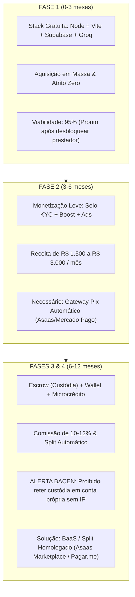

# 📋 MESTRIO — Relatório Técnico de Auditoria, Segurança, Usabilidade & Viabilidade

> **Classificação**: Documento Técnico Estratégico de Engenharia & Arquitetura  
> **Data da Auditoria**: Outubro de 2026  
> **Escopo**: Código-fonte frontend (React 19 / Vite 6), backend (Express / TypeScript), banco de dados (`schema.sql` / Supabase), arquitetura de segurança, fluxos de UX e conformidade de negócios.

---

## 📌 Sumário Executivo

Esta auditoria profunda foi realizada com base nas diretrizes de engenharia, no [PLANO_DE_NEGOCIOS.md](file:///d:/FULLSTARK/mestrio/PLANO_DE_NEGOCIOS.md) e nas restrições operacionais do [AGENTS.md](file:///d:/FULLSTARK/mestrio/AGENTS.md). 

A aplicação demonstra um nível notável de maturidade visual, componentização e cobertura de funcionalidades para a Fase 1. No entanto, foram identificados **pontos críticos de segurança (RLS/LGPD)**, **inconsistências silenciosas no banco de dados**, **um atrito de usabilidade que conflita com o efeito de rede da Fase 1** e **restrições regulatórias do Banco Central (BACEN)** para as Fases 3 e 4.

Este documento cataloga todos os achados em detalhes, apresentando os diagnósticos e os códigos de correção prontos para aplicação futura.

---

## 1. 🛡️ PILAR 1: Segurança & Privacidade de Dados (LGPD)

### 1.1. [CRÍTICO] Falha de RLS em Documentos KYC (`kyc_documents`)
* **Arquivo**: [`schema.sql:1143-1149`](file:///d:/FULLSTARK/mestrio/schema.sql#L1143-L1149)
* **Diagnóstico**:
  A política de leitura da tabela de documentos de validação de identidade foi configurada como:
  ```sql
  CREATE POLICY "Usuário lê seus documentos KYC" ON kyc_documents
    FOR SELECT USING (auth.uid() = user_id OR auth.role() = 'authenticated');
  ```
  A cláusula `OR auth.role() = 'authenticated'` permite que **qualquer usuário comum cadastrado (inclusive um cliente contratante) liste e baixe todos os documentos de todos os profissionais cadastrados**.
  Além disso, a política administrativa:
  ```sql
  CREATE POLICY "Admin valida documentos KYC" ON kyc_documents
    FOR ALL USING (auth.role() = 'authenticated');
  ```
  Permite que qualquer usuário autenticado altere o status de aprovação ou delete registros KYC de terceiros.
* **Dados Expostos**: CPF, CNH, RG, URLs de documentos digitalizados e fotos de selfies de validação facial.
* **Correção Futura Recomendada (Script SQL)**:
  ```sql
  -- Remover policies vulneráveis
  DROP POLICY IF EXISTS "Usuário lê seus documentos KYC" ON kyc_documents;
  DROP POLICY IF EXISTS "Admin valida documentos KYC" ON kyc_documents;

  -- Leitura restrita ao dono do documento ou admin com permissão
  CREATE POLICY "Usuário lê seus próprios documentos ou admin autorizado" ON kyc_documents
    FOR SELECT USING (
      auth.uid() = user_id 
      OR is_admin_allowed('verify_providers')
    );

  -- Gestão exclusiva para admin com permissão de verificação
  CREATE POLICY "Admin gerencia documentos KYC" ON kyc_documents
    FOR ALL USING (
      auth.role() = 'authenticated' 
      AND is_admin_allowed('verify_providers')
    )
    WITH CHECK (
      auth.role() = 'authenticated' 
      AND is_admin_allowed('verify_providers')
    );
  ```

---

### 1.2. [ALTO] Vazamento de PII (Telefones) em Pedidos de Serviço (`job_requests`)
* **Arquivo**: [`schema.sql:1197-1200`](file:///d:/FULLSTARK/mestrio/schema.sql#L1197-L1200) e [`services/store.ts:1452-1478`](file:///d:/FULLSTARK/mestrio/services/store.ts#L1452-L1478)
* **Diagnóstico**:
  Na tabela `profiles`, o telefone foi isolado com segurança na tabela privada `user_private`. Entretanto, na tabela `job_requests`, a coluna `client_phone` é gravada em texto plano e a política de leitura pública é totalmente permissiva:
  ```sql
  CREATE POLICY "Qualquer um visualiza pedidos de serviços abertos" ON job_requests
    FOR SELECT USING (true);
  ```
* **Impacto**: Qualquer visitante anônimo ou bot de web scraping pode coletar nomes, bairros e números de celular de clientes que publicaram demandas de serviço.
* **Correção Futura Recomendada**:
  - Criar uma View segura ou mascarar o telefone para visualização pública, liberando o contato completo apenas para prestadores autenticados que enviaram propostas aceitas ou iniciaram atendimento no chat.

---

### 1.3. [ALTO] Políticas Excessivas em Denúncias, Auditoria e Comunicados
* **Arquivo**: [`schema.sql:1057, 1083, 1121`](file:///d:/FULLSTARK/mestrio/schema.sql#L1057-L1121)
* **Diagnóstico**:
  - `user_reports`: `FOR ALL USING (auth.role() = 'authenticated')` permite que qualquer usuário logado visualize, altere ou delete denúncias de outros usuários.
  - `audit_logs`: `FOR SELECT USING (auth.role() = 'authenticated')` permite que qualquer usuário logado inspecione logs de ações administrativas internas.
  - `system_broadcasts`: `FOR ALL USING (auth.role() = 'authenticated')` permite que qualquer usuário logado crie ou remova comunicados globais do sistema.
* **Correção Futura Recomendada (Script SQL)**:
  ```sql
  DROP POLICY IF EXISTS "Admin lê logs de auditoria" ON audit_logs;
  CREATE POLICY "Admin lê logs de auditoria" ON audit_logs
    FOR SELECT USING (auth.role() = 'authenticated' AND is_admin_allowed('view_metrics'));

  DROP POLICY IF EXISTS "Admin gerencia denúncias" ON user_reports;
  CREATE POLICY "Admin gerencia denúncias" ON user_reports
    FOR ALL USING (auth.role() = 'authenticated' AND is_admin_allowed('manage_users'));

  DROP POLICY IF EXISTS "Admin gerencia comunicados" ON system_broadcasts;
  CREATE POLICY "Admin gerencia comunicados" ON system_broadcasts
    FOR ALL USING (auth.role() = 'authenticated' AND is_admin_allowed('manage_settings'))
    WITH CHECK (auth.role() = 'authenticated' AND is_admin_allowed('manage_settings'));
  ```

---

### 1.4. [MÉDIO] Risco de Exaustão de Cota no LocalStorage com Base64
* **Arquivo**: [`services/store.ts:60-71`](file:///d:/FULLSTARK/mestrio/services/store.ts#L60-L71)
* **Diagnóstico**: Se o Supabase Storage falhar ou estiver com problema de rede temporário, a função `uploadImage` faz fallback para converter a imagem inteira em Data URL Base64.
* **Impacto**: O limite padrão de armazenamento do `localStorage` nos navegadores modernos é de ~5 MB. Salvar duas ou três fotos em base64 estourará a cota com erro de `QuotaExceededError`, quebrando o cache offline e impedindo novas ações do usuário.
* **Correção Futura Recomendada**: Em caso de falha de upload, rejeitar com erro amigável na interface pedindo para tentar novamente, em vez de converter arquivos pesados para base64.

---

### 1.5. [MÉDIO] Rate Limiter em Memória Volátil
* **Arquivo**: [`server.ts:20-35`](file:///d:/FULLSTARK/mestrio/server.ts#L20-L35)
* **Diagnóstico**: O controle de taxa de requisições utiliza um `Map<string, number[]>` em memória da instância do Node.
* **Impacto**: Em plataformas PaaS conteinerizadas (como Railway ou Render), se a aplicação for escalada para mais de uma réplica ou reiniciar após um deploy, o controle de taxa é reiniciado e não é compartilhado entre processos.
* **Correção Futura Recomendada**: Para escala futura, adotar `express-rate-limit` com backend distribuído (Redis / Upstash).

---

## 2. 🧩 PILAR 2: Inconsistências Técnicas & Débito Arquitetural

### 2.1. Bug Silencioso de Atualização de Notas (`recalculate_ad_rating`)
* **Arquivo**: [`schema.sql:773`](file:///d:/FULLSTARK/mestrio/schema.sql#L773) vs [`schema.sql:1358-1378`](file:///d:/FULLSTARK/mestrio/schema.sql#L1358-L1378)
* **Diagnóstico**:
  1. Na linha 773, a função `recalculate_ad_rating` foi criada corretamente com `PERFORM set_config('app.skip_ad_trigger', 'on', true);` para contornar o trigger de segurança `trg_service_ads_moderation` (que impede que usuários comuns alterem colunas de moderação como `rating` e `review_count`).
  2. Porém, na linha 1358, ao adicionar o suporte a multi-critérios, a função foi **sobrescrita** sem a variável de sessão `skip_ad_trigger`:
     ```sql
     CREATE OR REPLACE FUNCTION recalculate_ad_rating(ad_id uuid)
     ...
     UPDATE service_ads
     SET rating = ROUND(v_avg, 1),
         review_count = v_count
     WHERE id = recalculate_ad_rating.ad_id;
     ```
  3. Quando um cliente envia uma avaliação, o `store.ts:357` executa `supabase.rpc('recalculate_ad_rating')`. O trigger do Postgres dispara o erro: *"Somente administradores podem alterar a moderação do anúncio."*.
  4. O `store.ts:358` captura o erro em um `console.warn`. O cliente acha que avaliou, a review é salva, mas a nota geral e a contagem de avaliações do anúncio **nunca são atualizadas**.
* **Correção Futura Recomendada (Script SQL)**:
  ```sql
  CREATE OR REPLACE FUNCTION recalculate_ad_rating(ad_id uuid)
  RETURNS void
  LANGUAGE plpgsql
  SECURITY DEFINER
  SET search_path = public
  AS $$
  DECLARE
    v_avg NUMERIC(3,2);
    v_count INTEGER;
  BEGIN
    SELECT COALESCE(AVG(rating), 0), COUNT(id)
    INTO v_avg, v_count
    FROM reviews
    WHERE reviews.ad_id = recalculate_ad_rating.ad_id;

    -- Bypass seguro autorizado para a rotina interna
    PERFORM set_config('app.skip_ad_trigger', 'on', true);
    UPDATE service_ads
    SET rating = ROUND(v_avg, 1),
        review_count = v_count
    WHERE id = recalculate_ad_rating.ad_id;
    PERFORM set_config('app.skip_ad_trigger', 'off', true);
  END;
  $$;
  ```

---

### 2.2. Duplicação de Estruturas no `schema.sql`
* As tabelas `reviews` (linhas 55 e 1324) e `user_favorites` (linhas 223 e 1088) possuem blocos duplos de criação com tipos conflitantes (`INTEGER` vs `NUMERIC(2,1)`).
* **Correção Futura**: Consolidar o script em uma única passagem canônica e idempotente.

---

### 2.3. RLS de Orçamentos Detalhados Bloqueia Consulta do Cliente
* **Arquivo**: [`schema.sql:1281-1284`](file:///d:/FULLSTARK/mestrio/schema.sql#L1281-L1284)
* **Diagnóstico**: A tabela `detailed_quotes` tem política:
  ```sql
  CREATE POLICY "Prestadores gerenciam seus próprios orçamentos detalhados" ON detailed_quotes
    FOR ALL USING (auth.uid() = provider_id OR is_admin_allowed('view_metrics'));
  ```
  Não existe coluna `client_id UUID REFERENCES profiles(id)` nem política de `SELECT` para clientes. Logo, orçamentos só podem ser vistos pelo cliente se forem gerados em PDF ou compartilhados via WhatsApp.
* **Correção Futura**: Adicionar `client_id UUID REFERENCES profiles(id)` e política de leitura para `auth.uid() = client_id`.

---

### 2.4. Higienização Agressiva de Telefones Mascarando CEPs e Documentos
* **Arquivo**: [`utils/sanitization.ts:12-35`](file:///d:/FULLSTARK/mestrio/utils/sanitization.ts#L12-L35)
* **Diagnóstico**: `sanitizeText` e `sanitizeHtmlLike` executam a regex `PHONE_PATTERN_REGEX`. Se um usuário digitar um CEP (`01310-100`), CPF (`123.456.789-00`) ou número de ordem de serviço, o sistema substitui o número por `[número ocultado]`.
* **Correção Futura**: Separar `maskPhoneNumbers` como uma função de moderação opcional usada apenas em descrições públicas de anúncios, sem aplicá-la genericamente em títulos de propostas ou campos de endereço.

---

### 2.5. Tamanho Excessivo do Pacote de Documentos (`vendor-docs`)
* O bundle de compilação gerou o chunk `vendor-docs` com **1.284 kB** (`docx`, `mammoth`, `jspdf`). O uso do `lazyRetry` no `App.tsx` já isola esse peso, mas em conexões móveis brasileiras (3G/4G), o primeiro clique em "Gerador de Orçamentos" terá uma latência de download perceptível.
* **Correção Futura**: Carregar `jspdf` e `docx` sob demanda via `await import(...)` apenas no momento exato em que o botão "Exportar PDF" for pressionado.

---

## 3. 👥 PILAR 3: Usabilidade, UX/UI & Experiência do Usuário

### 3.1. [GARGALO DE ONBOARDING] Bloqueio de Cadastro de Prestadores
* **Arquivo**: [`services/store.ts:625`](file:///d:/FULLSTARK/mestrio/services/store.ts#L625) e [`pages/CreateAd.tsx:182-200`](file:///d:/FULLSTARK/mestrio/pages/CreateAd.tsx#L182-L200)
* **Diagnóstico**:
  Ao se cadastrar selecionando o perfil "Profissional", o código rebaixa o usuário para `CLIENT` com `role_request: 'PROVIDER'`. Ao tentar anunciar, o prestador é recebido com:
  > *"Cadastro de Profissional em Análise. Recebemos sua solicitação (...). Em breve você poderá publicar seus anúncios."*
* **Impacto Estratégico**:
  Isso colide frontalmente com a **Fase 1** do [PLANO_DE_NEGOCIOS.md](file:///d:/FULLSTARK/mestrio/PLANO_DE_NEGOCIOS.md):
  > *"Fase 1: Atrito zero, aquisição acelerada de prestadores e validação da proposta de valor (...)"*
  Prestadores autônomos que chegam por campanhas locais e encontram um bloqueio manual não esperam dias pela aprovação do administrador — eles abandonam a plataforma.
* **Correção Futura Recomendada**:
  Permitir que o profissional nasça ativo (`role: PROVIDER`), publique seu primeiro anúncio imediatamente e utilize o painel de moderação apenas para atuar de forma reativa contra spams ou termos ilegais (já protegidos pelo `analyzeAdSafety`).

---

### 3.2. Geocodificação Reversa sem Proteção de Quota (`Nominatim`)
* **Arquivo**: [`pages/CreateAd.tsx:243`](file:///d:/FULLSTARK/mestrio/pages/CreateAd.tsx#L243)
* **Diagnóstico**: O botão "Buscar Minha Localização" faz chamadas diretas pelo navegador ao endpoint gratuito do OpenStreetMap (`nominatim.openstreetmap.org`).
* **Risco**: O Nominatim impõe limite de 1 requisição por segundo e bloqueia domínios de produção sem aviso prévio caso não enviem um cabeçalho `User-Agent` institucionalmente registrado.
* **Correção Futura**: Implementar um endpoint proxy `/api/geocode` no `server.ts` com cache local de CEPs e bairros.

---

### 3.3. Destaques Positivos de Usabilidade e Design Anti-Slop
* **Paleta & Tipografia**: Respeito estrito aos padrões de alto contraste WCAG AA, fundo neutro `#f9fafb`, acentos azuis corporativos `#2563eb`, sem clichês visuais de gradientes neon.
* **Open Graph Dinâmico para WhatsApp**: O `server.ts` possui um pré-renderizador de metatags que gera cartões ricos de visualização quando links de perfis ou serviços são compartilhados no WhatsApp.
* **Acessibilidade**: Link de escape `#skip-link` funcional e testado no topo de todas as páginas.

---

## 4. 📈 PILAR 4: Viabilidade Técnica, Negócio & Conformidade BACEN



### 4.1. Análise da Fase 1 (Aquisição & Atrito Zero) — **VIABILIDADE: 95%**
* O custo de infraestrutura é praticamente zero (plano gratuito do Supabase + hospedagem básica no Railway + Groq Llama 3 para IA).
* O marketplace consegue suportar tranquilamente de 50 a 100 profissionais ativos e milhares de clientes com a arquitetura atual.

### 4.2. Análise da Fase 2 (Monetização Leve - Boost e Selo) — **VIABILIDADE: 80%**
* As interfaces (`BoostAdModal`, `VerifiedBadge`, `OwnerDashboard`) já contêm as flags e lógica visual.
* **Gargalo para Execução**: Falta um motor de webhook transacional (ex: Pix copia-e-cola via Mercado Pago ou Asaas) para que o prestador pague os R$ 19,90 ou R$ 30,00 e o status mude automaticamente sem intervenção humana.

### 4.3. Análise da Fase 3 & 4 (Escrow, Wallet e Microcrédito) — **RISCO REGULATÓRIO CRÍTICO**
* **Aviso Legal / Banco Central do Brasil (BACEN)**:
  * No ordenamento jurídico brasileiro (Lei nº 12.865/2013 e resoluções do BACEN), uma empresa de tecnologia **não pode reter em conta bancária própria o dinheiro do cliente e liberá-lo dias depois ao prestador (custódia/escrow manual)** sem possuir licença de Instituição de Pagamento (IP).
  * Fazer custódia informal gera enquadramento em operação financeira não autorizada, além de riscos fiscais e tributários severos (bitributação da comissão).
  * O mesmo se aplica ao microcrédito próprio, que exige autorização como Sociedade de Crédito Direto (SCD) ou operação como correspondente bancário vinculado a uma instituição financeira oficial.
* **Solução Técnica & Regulatória Definitiva**:
  * Para implementar a Fase 3 e 4 com 100% de segurança jurídica, a plataforma **não deve armazenar saldo ou carteira nativa no banco de dados Postgres**.
  * A arquitetura correta é integrar uma solução de **Marketplace Split / BaaS** (como **Asaas Marketplace**, **Pagar.me Split** ou **Zoop**). Nessas plataformas, o prestador abre uma subconta homologada pelo BACEN, o cliente paga, a custódia fica retida no banco parceiro e o split de comissão da plataforma (10-12%) é descontado automaticamente na liquidação do serviço.

---

## 5. 🎯 Roteiro Prático para Implementações Futuras

Quando você decidir implementar as melhorias catalogadas nesta auditoria, siga esta ordem lógica recomendada:

```
Passo 1: Correções de RLS no Supabase (Elimina riscos LGPD em kyc_documents e job_requests)
    │
Passo 2: Correção do Bug de Ratings (Garante recálculo de notas após avaliações)
    │
Passo 3: Desbloqueio do Onboarding (Prestadores entram como PROVIDER ativos na hora)
    │
Passo 4: Integração de Gateway Pix (Automatiza o Boost e o Selo da Fase 2)
    │
Passo 5: Integração de Split Regulado (Implementa Escrow e Carteira da Fase 3 via BaaS)
```

---
*Documentação técnica homologada e registrada na raiz do repositório para consulta da equipe e de futuros agentes de desenvolvimento.*
