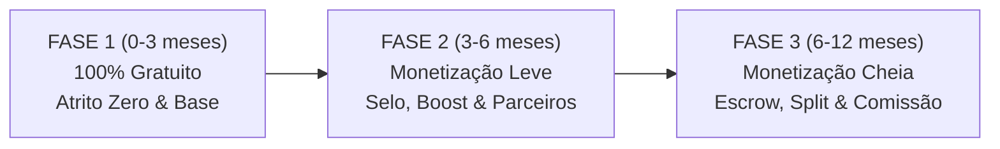

# 📑 MESTRIO — Documento Estratégico de Projeto & Plano de Negócios

**Classificação**: Documento Confidencial de Estratégia de Negócios  
**Versão**: 1.0  
**Mercado-Alvo Inicial**: Serviços Gerais Residencial (Foco: *Eletricista, Ar-Condicionado, Marido de Aluguel*)

---

## 📌 Visão Geral do Modelo de Evolução

O **Mestrio** é uma plataforma marketplace geolocalizada conectando clientes a prestadores autônomos de serviços. A estratégia de crescimento do negócio está dividida em **3 Fases Progressivas**, focando primeiramente na aquisição com atrito zero, seguida por monetização leve e, finalmente, monetização cheia transacional.

---

## 🚀 FASE 1: 0 a 3 Meses — Atração & Atrito Zero (100% Gratuito)

> **Foco Estratégico**: Atrito zero, aquisição acelerada de oferta de profissionais e validação da proposta de valor no mercado local.

### 💰 Modelo Financeiro
- **Preço para Usuários**: **R$ 0,00** (100% Gratuito para Clientes e Profissionais)
- **Receita Mensal**: R$ 0,00

### 🔧 Funcionalidades & Escopo de Produto
- Cadastro gratuito de Profissionais e Clientes.
- Busca local geolocalizada por proximidade com Mapa Interativo (Leaflet).
- Chat interno em tempo real + Sistema de agendamento simples.
- Redirecionamento direto para o WhatsApp do profissional.
- Niche inicial de atuação: **Eletricista, Ar-Condicionado, Marido de Aluguel**.

### 📊 Metas & Indicadores Chave (KPIs)
- **Profissionais Ativos**: 30 a 50 profissionais cadastrados.
- **Clientes Cadastrados**: 200 a 300 clientes.
- **Atendimentos Efetuados**: 50 a 100 serviços realizados.
- **Tempo Médio de Resposta**: < 30 minutos no chat/WhatsApp.
- **NPS (Satisfação dos Usuários)**: > 8.0.

---

## 💳 FASE 2: 3 a 6 Meses — Monetização Leve (SaaS + Destaques + Parcerias)

> **Foco Estratégico**: Introduzir fontes de receita leves que agreguem valor percebido aos profissionais sem desacelerar o crescimento de cadastros.

### 🔧 Funcionalidades & Escopo de Produto
- **Selo Mestre Verificado**: Validação de identidade e documentos oficiais (KYC).
- **Algoritmo de Destaque / Boost de Categoria**: Posicionamento prioritário nos resultados de busca.
- **Painel de Métricas Pro para o Profissional**: Dashboard individual de visualizações e mensagens recebidas.
- **Notificações Automáticas via WhatsApp (Twilio / Z-API)**: Lembretes de agendamentos para clientes e prestadores.
- **Anúncios de Parceiros Locais**: Espaços publicitários para lojas de materiais de construção, ferramentas e equipamentos.

### 💰 Modelo de Receita da Fase 2
- **Selo Verificado**: R$ 19,90 / mês por profissional.
- **Boost de Categoria**: R$ 30,00 a R$ 50,00 / semana por anúncio.
- **Parcerias Locais**: R$ 200,00 a R$ 500,00 / mês por patrocinador local.
- **Receita Mensal Projetada**: **R$ 1.500,00 a R$ 3.000,00 / mês**

### 📊 Metas & Indicadores Chave (KPIs)
- **Profissionais Ativos**: 80 a 100 profissionais.
- **Clientes Cadastrados**: 500+ clientes.
- **Atendimentos Efetuados**: 200+ serviços por mês.

---

## 🏛️ FASE 3: 6 a 12 Meses — Monetização Cheia (Escrow + Financiamento + Comissão)

> **Foco Estratégico**: Transformação em infraestrutura financeira completa de pagamentos, retendo o valor em custódia e automatizando a cobrança de comissões por serviço.

### 🔧 Funcionalidades & Escopo de Produto
- **Carteira Digital com Escrow**: Retenção do pagamento em custódia garantindo segurança para ambas as partes. O valor só é liberado ao prestador após a confirmação de entrega do serviço pelo cliente.
- **Split de Pagamento Automático**: Repasse instantâneo da comissão da plataforma e da taxa do prestador.
- **Parcelamento / Financiamento de Serviços (3x a 12x)**: Facilidade para o cliente contratar serviços de maior valor (ex: instalações completas e reformas).

### 2. Modelo de Receita da Fase 3
- **Comissão sobre Serviço**: 10% a 12% por serviço concluído.
- **Taxa de Carteira + Float**: 2% a 3%.
- **Comissão de Financiamento**: 2% a 5%.
- **Receita Mensal Projetada**: **R$ 8.000,00 a R$ 15.000,00 / mês**
- **GMV Mensal (Volume Bruto Transacionado)**: **R$ 100.000,00+ / mês**

---

## 📋 Resumo Comparativo das Fases

| Parâmetro | FASE 1 (0 a 3 meses) | FASE 2 (3 a 6 meses) | FASE 3 (6 a 12 meses) |
| :--- | :--- | :--- | :--- |
| **Modelo de Cobrança** | 100% Gratuito | SaaS + Destaque + Ads | Comissão + Escrow + Financiamento |
| **Preço Profissional** | R$ 0,00 | Selo (R$ 19,90/mês) / Boost (R$ 30-50/sem) | 10% a 12% por serviço |
| **Receita Mensal** | R$ 0,00 | R$ 1.500 a R$ 3.000 /mês | R$ 8.000 a R$ 15.000 /mês |
| **Meta de Profissionais** | 30 a 50 ativos | 80 a 100 ativos | 200+ ativos |
| **Meta de Clientes** | 200 a 300 cadastrados | 500+ cadastrados | 2.000+ cadastrados |
| **GMV Mensal Estimado** | R$ 10.000 /mês | R$ 35.000 /mês | R$ 100.000+ /mês |
